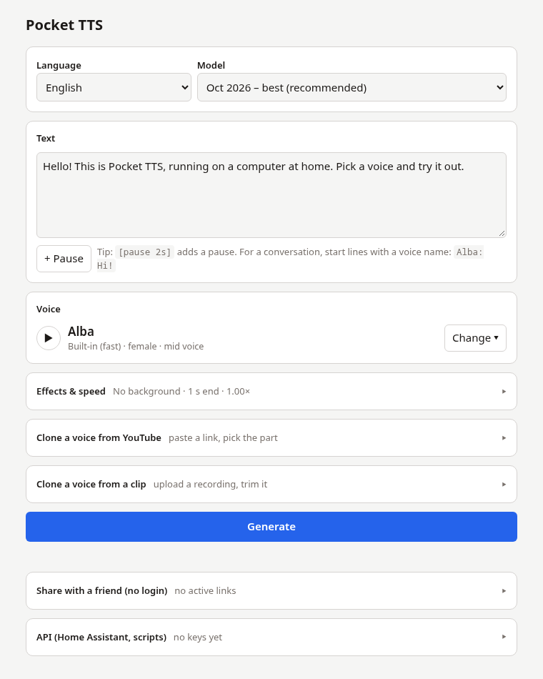
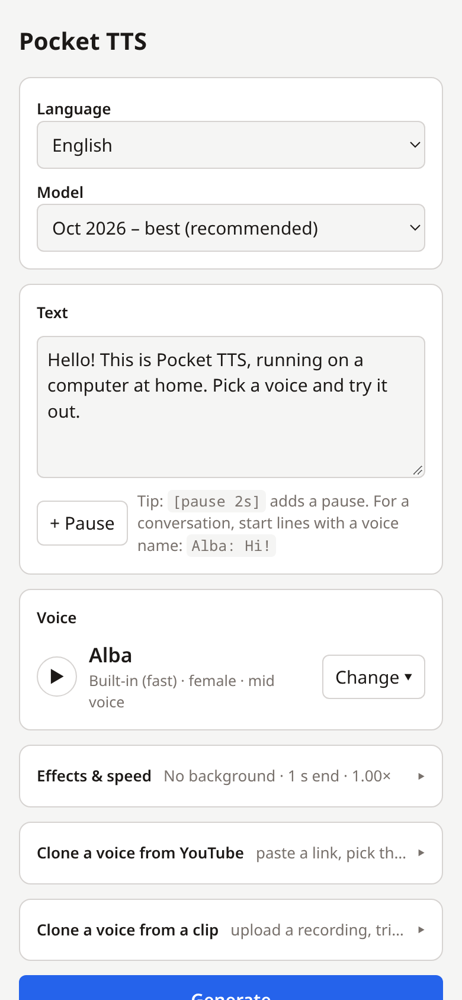
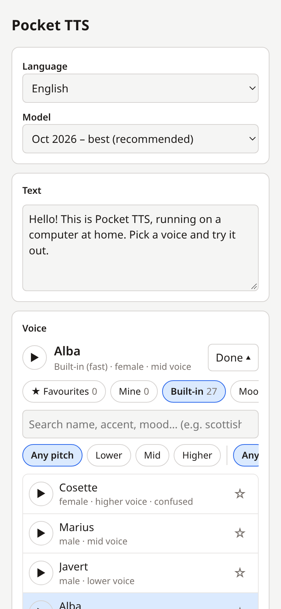

# pocket-tts-web

A self-hosted web page for [Kyutai Pocket TTS](https://github.com/kyutai-labs/pocket-tts): fast text-to-speech
that runs on an ordinary CPU, with voice cloning.

<p align="center">
  
  &nbsp;
  
  &nbsp;
  
  <br><em>Desktop and phone: the same page, made to work one-handed on a phone too.</em>
</p>

- **~690 voices** from Kyutai's voice library, with a browser: tabs, search, pitch / gender / accent / mood filters,
  ▶ previews, favourites
- **Clone a voice** from an uploaded clip (any format a phone records, e.g. WhatsApp `.ogg` voice notes) or from a
  **YouTube** segment picked with a slider
- **7 languages** (English, French, German, Spanish, Italian, Portuguese, Dutch); extra models install from the page
- **Background ambience** (street, café, rain, …) at low / medium / high, plus a little extra time at the end
- **Share links**: give a friend a login-free link that expires (1 h – 7 days), revoke it any time
- **Pauses** (`[pause 2s]`), **speed** 0.7–1.5× (pitch kept), **expressiveness** (steady ↔ lively), and **conversations**: lines like `Alba: Hi!` /
  `George: Hello.` become one clip with several voices
- **Trim** uploaded clips with a slider, and a **history** of your last 20 clips
- An **API** with keys, for Home Assistant, scripts or chat bots (MP3 / OGG / WAV)
- Download as **WAV** or **OGG** (Opus, voice-note size). Audio streams while it is generated.

Everything runs on your machine; nothing is sent to an outside service except downloads (models, voices, YouTube).

## Requirements

- Linux or macOS, 2+ CPU cores, ~4 GB disk, ~1 GB RAM (+0.2–0.5 GB per extra model in use). No GPU needed.
- `ffmpeg`
- [uv](https://docs.astral.sh/uv/) (recommended, it also fetches the right Python) or Python 3.10–3.14
- A free **Hugging Face account** for voice cloning (see below)

## 1. Hugging Face access (for voice cloning)

The built-in voices work without an account. Cloning voices from your own clips uses Kyutai's gated model, so:

1. Create an account at <https://huggingface.co/join>
2. Open <https://huggingface.co/kyutai/pocket-tts> while logged in and **accept the terms**
3. Log in on the machine (the setup script offers to do this, or run it yourself after setup):

   ```bash
   .venv/bin/hf auth login
   ```

   It shows a short code to enter at <https://hf.co/oauth/device>, or you can paste an access token
   (<https://huggingface.co/settings/tokens>, "Read" is enough). The token is stored in `~/.cache/huggingface/`.

The account is only used to download the model files once; generation runs locally.

## 2. Install

```bash
git clone <this repo> pocket-tts-web
cd pocket-tts-web
./setup.sh              # or ./setup.sh --service to also install a systemd user service
```

`setup.sh` creates `.venv` with CPU-only PyTorch, checks your Hugging Face access, and downloads + builds the
background sounds (~100 MB from Wikimedia Commons; skip with `--no-noise`). It is safe to run again.

<details><summary>Manual install</summary>

```bash
uv venv --python 3.12 .venv
uv pip install --python .venv/bin/python -r requirements.txt --index-strategy unsafe-best-match
.venv/bin/hf auth login
noise/fetch.sh && noise/build.sh
```
</details>

## 3. Run

```bash
.venv/bin/python web/app.py --port 18700
```

Open <http://127.0.0.1:18700>. The first start downloads the English model (~200 MB); voices download the first time
you preview or use them. With `./setup.sh --service` it runs as `pocket-tts` under `systemctl --user`
(logs: `journalctl --user -u pocket-tts -f`; `loginctl enable-linger $USER` keeps it running when you log out).

## 4. Putting it online

> **The app has no login of its own.** It listens on `127.0.0.1` only. If you make it reachable from the internet,
> put a reverse proxy with a login in front of it, and let **only `/s/*`** (share links) and **`/api/*`** (needs an
> API key) through without login.

[`deploy/Caddyfile.example`](deploy/Caddyfile.example) shows this with Caddy and basic auth; forward auth to
Authentik, oauth2-proxy etc. works the same way. Allow uploads of ~50 MB in the proxy.

Share-link guests can use the installed models and the voice library, upload / YouTube-clone their own voices
(kept in `voices/guests/`), max 3000 characters per text, one generation at a time per link. They cannot see your
own clones unless you mark one as shared (👥), install models, or delete anything.

## API

Create a key in the page's **API** card (it is shown once; only a hash is stored). Then:

```bash
# MP3 that any speaker or player can fetch directly
curl -o hello.mp3 "http://127.0.0.1:18700/api/tts.mp3?key=YOUR_KEY&voice=alba&text=The%20washing%20machine%20is%20done."

# POST with JSON; pauses, conversations, background and speed work too
curl -o door.ogg -H "Authorization: Bearer YOUR_KEY" -H "Content-Type: application/json" \
     -d '{"text": "Someone is at the door. [pause 1s] Go and look!", "voice": "George", "format": "ogg", "bg": "rain"}' \
     http://127.0.0.1:18700/api/tts
```

Parameters: `text` (required, max 5000 chars), `voice` (id or name, see `GET /api/voices`), `model`, `format`
(`mp3` default, `ogg`, `wav`, or put it in the path: `/api/tts.mp3`), `bg`, `bg_level` (low/medium/high), `speed`,
`tail`, `expressiveness` (0.1–1.0, default 0.3). The key goes in `?key=`, `X-API-Key:` or `Authorization: Bearer`.

Security: keys are long random tokens, stored only as hashes; 10 wrong keys from one address within 10 minutes get
that address blocked for a while.

Caching: an identical request within 10 minutes is answered from memory (last 50 clips), and one that arrives while
the same clip is still being generated waits for it. So a client can "prefetch" a clip (send the request early and
ignore the answer) and the real request moments later is instant, e.g. play a short sound first, then the speech. If you use `?key=` in URLs, blank it out of your proxy's access log
(see the `log` block in [`deploy/Caddyfile.example`](deploy/Caddyfile.example)).

**Home Assistant** example (a Cast speaker fetches the URL itself, so it must be reachable from the speaker):

```yaml
action: media_player.play_media
target:
  entity_id: media_player.kitchen
data:
  media_content_type: music
  media_content_id: "https://tts.example.com/api/tts.mp3?key=YOUR_KEY&voice=alba&text=Dinner%20is%20ready"
```

## Files

| Path | What |
|---|---|
| `web/app.py` | the server (FastAPI around `pocket_tts`) |
| `web/index.html` | the page |
| `web/voices.json` | voice catalog, rebuilt by `web/build_catalog.py` (+ `web/pitch.py`, `web/meta/`) |
| `web/models.json` | models shown in the page |
| `noise/` | background sounds: `fetch.sh` downloads, `build.sh` builds loops, `credits.json` = sources + licences |
| `voices/` | your clones (not in git). Deleting in the page moves files to `voices/.deleted/` |
| `state/` | share links, favourites (not in git) |
| `pt.sh`, `yt-voice.sh` | command-line helpers |

## Use responsibly

Only clone voices of people who have agreed to it, and don't use cloned voices to impersonate or deceive anyone.
This is also a condition of Kyutai's voice-cloning model. Downloading from YouTube may be against YouTube's terms
or the uploader's rights; that is your responsibility.

## Licences and credits

This project's code is [MIT](LICENSE). Third-party parts: see [THIRD_PARTY.md](THIRD_PARTY.md). In short: Pocket TTS is MIT; the voices and background recordings keep their own
licences (some voice sets are **non-commercial only**), and this repo does not contain any of the audio itself.
